# REWIND — 기획·개발 포트폴리오

> 카세트 플레이어의 되감기 버튼으로 죽음을 되돌리는, 현대 도시 배경의 3인칭 누아르 액션 게임

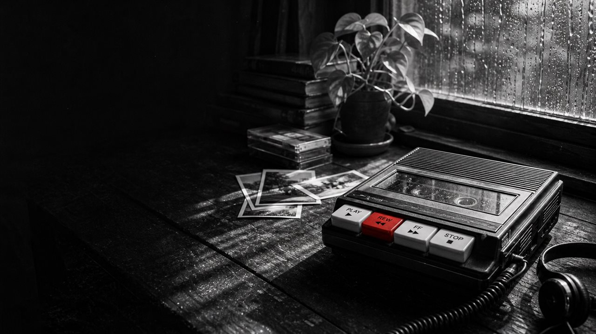

| 항목 | 내용 |
|---|---|
| 장르 | 3인칭 액션 · 잠입 (선형 진행, 넓은 필드) |
| 엔진 | Unity 6 (6000.3.18f1), URP 17.3 |
| 플랫폼 | Windows PC |
| 개발 기간 | 2026-09-30 ~ 2026-10-19 (20일) |
| 분량 | 타이틀 → 프롤로그 → 1~5장 → 종장(엔딩 2종) → 크레딧 |
| 코드 | 게임 스크립트 61개(15,905줄) · 에디터 도구·빌더·시험 60개(16,966줄) |
| 저장소 | [github.com/SenaJuo/FProject](https://github.com/SenaJuo/FProject) (`main`) |

---

## 한눈에 보기

| | |
|---|---|
| **핵심 재미** | 죽으면 카세트를 되감는다. 횟수는 테이프에 든 만큼만 쓰는 자원이고, 되감은 뒤에는 **레이만** 지워진 몇 초를 기억해 다음 시도의 무기로 쓴다 |
| **직접 만든 되감기 엔진** | 외부 에셋 없이 `TimeRewind` + `IRewindable`(13개 구성 요소)로 세상 상태를 초당 20번 기록하고 VCR처럼 거꾸로 재생한다 |
| **주인공 얼굴** | 텍스처 31조각에 흩어져 녹은 듯 보이던 얼굴을 Blender에서 한 장으로 다시 굽고, 표정 8개 · 깜빡임을 넣어 싸움 · 아픔 · 말하기에 따라 표정이 바뀐다 |
| **코드로 짓는 장면** | 프롤로그와 1~5장 전부를 에디터 빌더가 처음부터 만든다. 맵 크기를 바꿀 때도 숫자를 고치고 다시 짓는다 |
| **카세트 누아르 UI** | 창은 카세트 덱 앞판 · 가죽 테이프 가방 · 레코드 가게 나무 계산대, 단추는 하이파이 덱 누름 단추, 테이프는 실제 카세트 사진 — 모두 VARCO 이미지 생성으로 만들고 9칸 늘이기로 그린다 |
| **자동 검증** | 플레이 모드 시험 21종, 실제 입력만 쓰는 플레이 봇, 해상도 8종 × 화면 40종 글자 검사 |
| **성능** | 출시 빌드 평균 1.9~3.0ms(339~518fps, RTX 3070), 최악 프레임 12.6ms. 처음 글자를 쓸 때의 끊김 최대 114ms를 글꼴 예열로 없앰 |
| **만든 방식** | 기획·디렉션·플레이 검수는 SenaJuo, 구현은 AI 코딩 도구(Claude Code)와 협업, 3D·소리·음악은 VARCO 생성 결과를 품질 관문으로 걸러 사용 |

---

## 목차
1. [한 줄 기획](#1-한-줄-기획)
2. [이야기와 세계관](#2-이야기와-세계관)
3. [장 구성](#3-장-구성)
4. [핵심 시스템: 되감기와 카세트테이프](#4-핵심-시스템-되감기와-카세트테이프)
5. [전투](#5-전투)
6. [잠입](#6-잠입)
7. [적 설계](#7-적-설계)
8. [UI·UX](#8-uiux)
9. [기술 구현](#9-기술-구현)
10. [에셋 제작 파이프라인](#10-에셋-제작-파이프라인)
11. [품질 검증 체계](#11-품질-검증-체계)
12. [최적화](#12-최적화)
13. [개발 과정과 의사결정](#13-개발-과정과-의사결정)
14. [알려진 문제와 다음 작업](#14-알려진-문제와-다음-작업)
15. [크레딧·출처](#15-크레딧출처)

---

## 1. 한 줄 기획

**"죽어도 되감으면 된다 — 단, 되감을 테이프가 남아 있다면."**

- 주인공 **레이**는 경찰 내부 비리를 캐다 쫓겨난 전직 형사입니다.
- 친구 **대니**가 보낸 카세트 플레이어에는 시간을 되감는 힘이 있습니다.
- 되감기는 **테이프에 든 횟수**만큼만 쓸 수 있고, 한 번 쓴 횟수는 다시 차지 않습니다. 새 횟수는 테이프 가게에서 다 쓴 테이프를 바꿔야 얻습니다.
  → 되감기는 공짜 부활이 아니라 **아껴 쓰는 자원**입니다.
- 되감으면 세상은 아무것도 모른 채 돌아가지만, **레이만 지워진 몇 초를 기억합니다**. 그 기억이 다음 시도의 무기가 됩니다(들킨 순찰의 시야, 맞았던 적의 공격 타이밍).

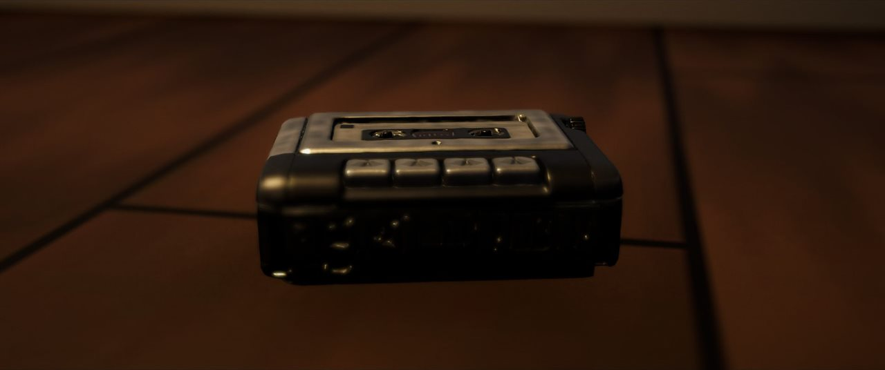
*대니가 보낸 카세트 플레이어. 트레일러는 이 플레이어의 재생 버튼으로 시작합니다.*

### 설계 원칙
| 원칙 | 적용 |
|---|---|
| 선형이지만 막힌 느낌이 없게 | 복도형 맵 대신 넓은 필드를 차례로 잇는다. 구역 경계는 벽 대신 지형·건물로 막는다. 단, 걷기만 하는 빈 땅은 줄인다 |
| 되감기는 자원 | 테이프 1개당 최대 3회, 1회 = 5초. 레벨·경험치·돈은 없다 |
| 레이만 기억한다 | 되감기 뒤 적은 모르고, 플레이어만 이득을 얻는다(유령·미끼 같은 비현실 연출은 쓰지 않는다) |
| 화면에 글자는 최소로 | 조작 안내를 상시 표시하지 않는다. 설명은 처음 한 번만, 다시 보기는 Esc 메뉴에서 |
| 배경은 현재 | 현대 도시·현대 경찰서. 카세트 플레이어처럼 레이의 취향을 보여 주는 몇 가지만 의도된 레트로 소품 |

---

## 2. 이야기와 세계관

### 줄거리
새벽 1시, 레이는 대니가 보낸 택배를 엽니다. 안에는 낡은 카세트 플레이어와 편지가 들어 있습니다.
> "이건 평범한 카세트 플레이어가 아니야. 테이프가 돌아간 만큼… 시간을 되감을 수 있어."

대니의 집에는 이미 조직원들이 와 있었고, 레이는 그 자리에서 총에 맞습니다. 쓰러지며 떨어진 플레이어의 되감기 버튼이 눌리고, 시간은 **대니 집 문 앞까지 1분 넘게** 되돌아갑니다. 나중에 읽은 편지 뒷면에는 되감기가 딱 5초씩이라고 적혀 있습니다.

레이는 대니의 죽음을 쫓아 들어갑니다. 대니가 남긴 녹음, 경찰서 증거물 보관실, 음반사 본사의 실험실, 산 위 송신소를 거쳐, 이 모든 것의 중심인 **마스터 테이프**(처음까지 전부 되감는 테이프)에 다가갑니다.

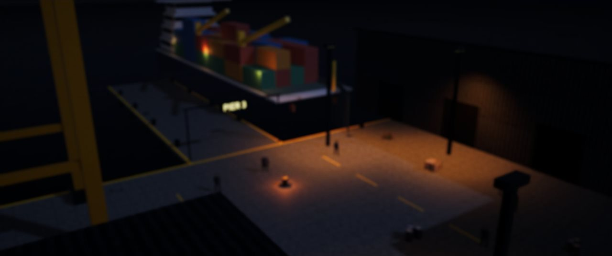
*1장의 마지막 무대, 밤의 3번 부두.*

### 세계관 핵심
- **한결 레코드 · 한결 FM**: 겉으로는 음반사이자 라디오 방송사입니다. 지하에서는 사람의 극한 감정을 녹음해 테이프를 만드는 실험을 합니다.
  > "그 사람들… 울음을 녹음해요. 공포, 분노… 끝까지 짜내면 테이프가 길어진대요." (3장, 녹음 대상 7번)
- **한결 물류**: 직원도 사무실도 없는 서류상의 회사입니다. 범행 차량 임대와 뒷돈 송금에 쓰입니다.
- **윗선**: 회장, 경찰청 차장, 국회의원. 한결 FM 30주년 방송 날 밤에 모입니다.
- **배신자**: 레이의 옛 파트너. 지금은 정보과장으로, 대니 사건 종결에 결재한 사람입니다.

### 주요 인물
| 인물 | 역할 |
|---|---|
| 레이 | 주인공. 쫓겨난 전직 형사, 음악과 아날로그를 좋아한다 |
| 대니 | 레이의 오랜 친구이자 경찰. 조직 쪽에서 일하다 실험을 보고 돌아섰고, 플레이어를 훔쳐 레이에게 보낸 뒤 살해된다 |
| 옛 파트너 | 레이의 전 파트너, 정보과장. 2장 끝에서 얼굴을 드러내고, 4장에서 결판이 난다 |
| 정리반 반장 | 1장 보스. 레이의 선배였던 전직 형사 |
| 녹음 대상 7번 | 3장에서 레이가 구한 실험체. 5장에서 테이프 가게를 연다 |
| 실험체 0번 | 5장 보스 |
| 가게 주인들 | 회사에서 도망친 사람들. 테이프 가게는 저장 지점이다 |

### 엔딩 (5장 끝의 선택)
마스터 테이프를 손에 넣은 레이는 대니의 녹음을 30주년 생방송에 내보냅니다. 그리고 선택합니다.
- **R 길게(1.2초) — 엔딩 A 「다시, A면」**: 처음까지 되감습니다. 일주일 전, 대니의 전화가 울립니다. 폭로는 사라지지만 레이만 모든 것을 기억합니다.
  > "이번엔 받지 않아. 내가 지금 그리로 간다. 그리고 이번엔— 둘 다 산다."
- **F — 엔딩 B 「끝난 테이프」**: 테이프를 부숩니다. 열두 명이 체포되고 실종자 스물세 명이 발견됩니다. 대니는 돌아오지 않습니다.
  > "…잘 가라, 대니. 네 B면은 내가 끝까지 들었다."

---

## 3. 장 구성

모든 장면은 코드로 만들어집니다(→ [9-2](#9-2-코드로-만드는-장면)). 장이 바뀌면 테이프와 회복약을 다음 장으로 넘깁니다(`SaveGame.CarryOver`).

| 장 | 제목 | 무대 | 흐름 | 저장 지점 | 보스 |
|---|---|---|---|---|---|
| 프롤로그 | PROLOGUE | 레이의 집 → 밤거리 → 대니의 집 | 1회차: 택배 → 대니 집 → 총에 맞음 → 되감김 / 2회차: 다시 대니 집, 싸움, 뒷창문 탈출 → 편지 뒷면 → 되감기 연습 | 없음 | — |
| 1장 | B면 | 대니네 거리·근린공원 → 시장 광장(검문소) → 3번 부두 | 손전등 순찰 잠입, 강제 첫 되감기 → 출구 싸움 → 방패 경찰·옥상 저격수 → 심문 → 항구 탐조등 → 보스 → 테이프 소각 막기(되감기) → 새벽, 대니의 녹음 | 5곳 | 정리반 반장 (HP 320) |
| 2장 | 내사 | 경찰서 뒷골목 → 압수차량 보관소 → 경찰서 2층 → 탈출 | 탐조등·순찰 잠입 → 검은 승합차 수색 → 출입증으로 잠입 → 비밀번호 패널(0417) → 대니 사건 상자 → 기록실 → 경보, 정리반·특공대 → 배신자 얼굴 | 7곳 | 정리반 부반장 (HP 260) |
| 3장 | 한결 레코드 | 항만로 1번지 → 한결 타워 하역장 → 녹음실 층 → 옥상 금고실 | 하역장 잠입(경비·CCTV) → 실험 부스: 7번이 쓰러짐 → 되감아 장비를 끔 → 실험체 셋 → 옥상 정리반 → 빈 금고, 옛 파트너와 결투(40%에서 도주) | 5곳 | 옛 파트너 (HP 280) |
| 4장 | 송신소 | 국도변 → 굽잇길 → 한결 FM 송신소·송신탑 | 정리반 매복 → 파트너와 결투 → 저격당함 → 1분 가까이 되감김(연출) → 저격수 먼저 처리 → 재결투 → 자백 → 입막음 | 4곳 | 옛 파트너 (HP 320) |
| 5장 | 30주년 | 본사 지하 주차장 → 연구소(B3) → 마스터 테이프 홀 | 7번의 가게 → 주차장 싸움 → 실험체들 → 0번 → 마스터 테이프 → 생방송 → 선택 → 엔딩 → 크레딧 | 4곳 | 실험체 0번 (HP 420) |

| | | |
|---|---|---|
| 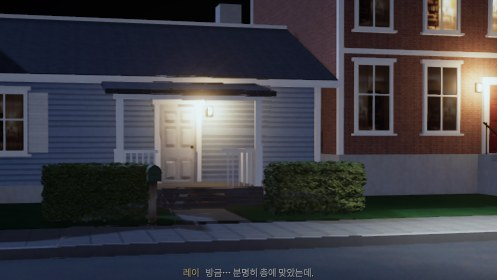 프롤로그 — 밤의 주택가 | 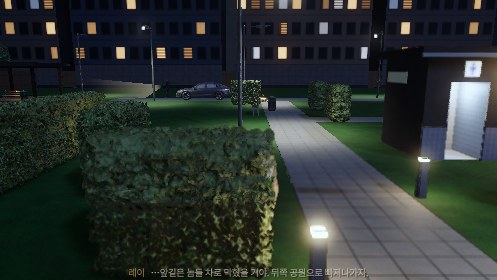 1장 B면 — 근린공원 | 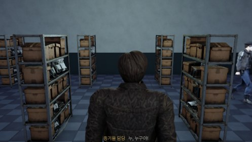 2장 내사 — 경찰서 |
| 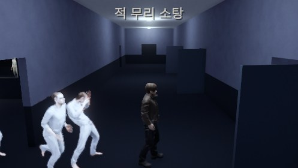 3장 한결 레코드 — 본사 | 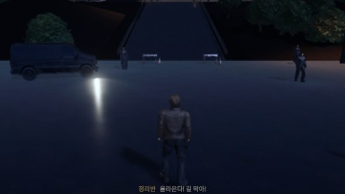 4장 송신소 — 산길 | 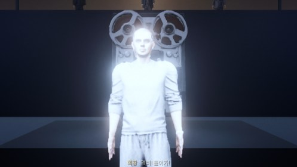 5장 30주년 — 0번 |

### 장별 핵심 연출
- **프롤로그**: 1회차 레이는 되감기를 모릅니다. 죽는 순간 기록이 거꾸로 재생되고, 2회차는 되감기가 잠긴 채 싸웁니다. 편지 뒷면을 읽은 뒤에야 되감기와 튜토리얼이 열리고, 첫 되감기는 횟수를 쓰지 않는 연습입니다. "…정말 딱 5초야. 그럼 아까 그건… 대체 뭐였지?"
- **1장**: 보스가 테이프를 태우러 달려가면 되감아서 막아야 합니다. 실패 상태는 없고, 늘 아슬아슬하게 막는 경주입니다.
- **2장**: 경찰은 잠입 전용이라 들키면 되감거나 붙잡힙니다. 증거물 보관실은 담당이 누르는 번호를 엿보고 패널에 직접 입력하며, 안에 담당이 있으면 제압하거나 싸웁니다.
- **3장**: 처음 조정실에 들어서면 유리 너머에서 7번이 쓰러집니다. 레이만 그 미래를 기억하고, 되감아 녹음 장비를 먼저 끕니다. 실험 부스의 시작은 되감기로 지워지지 않아서, 되감으면 처음부터 다시 진행됩니다.
- **4장**: 결투 중 원거리 저격으로 레이가 쓰러지면 연출로 긴 되감기가 일어나고, 이번에는 저격수를 먼저 처리합니다. 파트너가 무전으로 "또 일어났다"고 보고하며 조직의 추적이 시작됩니다.
- **5장**: 유리 관람석의 윗선이 지켜보는 가운데 0번과 싸웁니다. HP 50%에서 특수경비 둘이 합류합니다.

---

## 4. 핵심 시스템: 되감기와 카세트테이프

### 4-1. 되감기 규칙
| 항목 | 값 | 근거 |
|---|---|---|
| 되감기 1회 | 5초 | `Walkman.secondsPerCharge = 5` |
| 테이프 1개 최대 횟수 | 3회 | `CassetteTape.MaxCharges = 3` |
| 기록 길이 · 빈도 | 16초 · 초당 20번 | `TimeRewind.HistoryLength = 16`, `RecordInterval = 0.05` |
| 되감기 재생 속도 | 4배 (5초를 1.25초에) | `Walkman.playbackSpeed = 4` |
| 쓰러진 뒤 되감으면 | 1.5초 무적 | `invulnerableAfterDeathRewind = 1.5` |

- **R을 누르고 있으면** 세상이 비디오테이프처럼 거꾸로 재생되고, 손을 떼면 다음 5초 눈금에서 멈춥니다.
- **쓰러지면** 'REWIND' 화면이 뜹니다. R은 되감기, Space는 되감기를 아끼고 마지막 저장 지점에서 다시 시작합니다.
- **되감기는 물리적**입니다. 3회가 든 테이프를 1회만 감으면 2회가 남습니다.

| | |
|---|---|
| 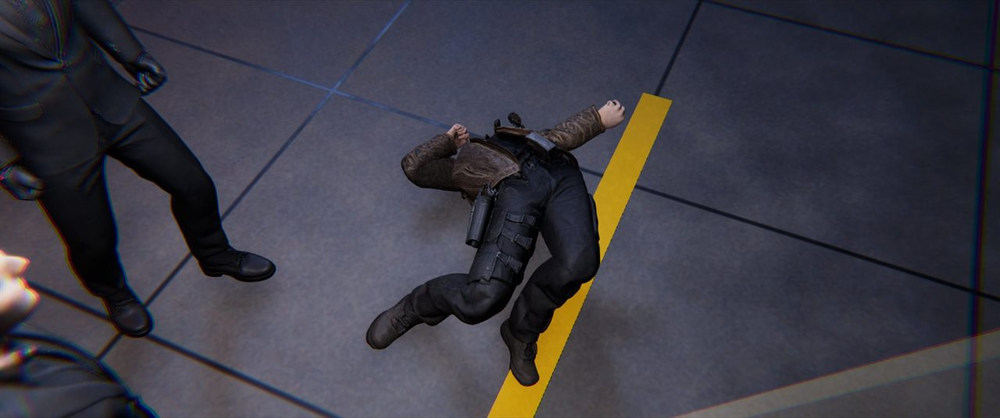 쓰러지는 순간 | 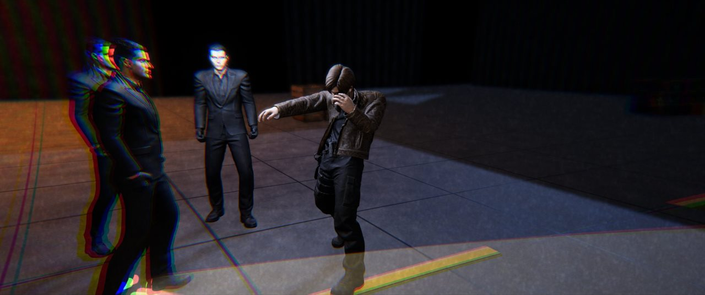 R — 세상이 테이프처럼 거꾸로 감긴다 |

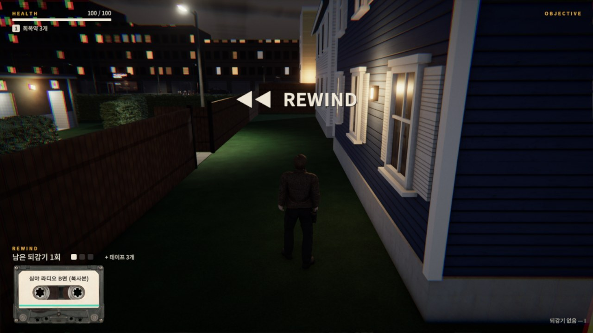
*쓰러지면 뜨는 REWIND 화면. 왼쪽 아래 카세트 위젯이 남은 되감기 횟수(□□□)와 예비 테이프 수를 보여 줍니다.*

### 4-2. 테이프
| 종류 | 얻는 곳 | 재생 | 횟수 |
|---|---|---|---|
| 재생용 테이프 | 테이프 가게(저장 지점)에서 교환 | 된다 — 노래가 계속 흐른다 | 받을 때 3회, 다시 차지 않음 |
| 주운 테이프 | 필드(회복약과 함께 놓임) | 안 된다 (되감기 전용) | 처음부터 1~2회 들어 있음 |

- **횟수는 소모품입니다.** 되감기(Q)나 능력(E)에 쓰면 줄고, 0이 되면 '다 쓴 테이프'입니다.
- **노래는 끊기지 않습니다.** 횟수를 다 써도 끼운 테이프의 노래는 계속 흐릅니다(끝나면 처음부터). 끼운 테이프가 비면 R은 노래를 바꾸지 않고 횟수가 남은 다른 테이프를 씁니다.
- **테이프 가게**: 진열대에서 받을 테이프를 고른 뒤, 내줄 테이프를 고릅니다. 값은 **다 쓴 테이프 1개**, 또는 **되감기용(장르 없는) 테이프의 남은 횟수 합 3회 이상**(예: 1회짜리 + 2회짜리)입니다. 받은 테이프는 3회가 꽉 찬 채로 옵니다. 진열대에는 테이프마다 능력 이름 · 시간 · 한 줄 설명이 보입니다.
- 가게는 들르면 체력이 모두 회복되는 저장 지점입니다. 화톳불처럼 길 위에 자연스럽게 놓이며, 찾아가는 목표로 만들지 않습니다.
- **음악**: 가게 테이프의 노래는 모두 VARCO Sound로 만든 곡입니다(테이프 10종, 26곡). 싸우는 중에도 흐릅니다.
- **설계 변경**: 처음에는 "곡이 끝날 때마다 +1, 재생용 테이프로 되감으면 다시는 재생되지 않음"이라는 교환 관계였습니다. 플레이해 보니 규칙이 헷갈리고, 능력으로 비운 테이프가 가게에서 '다 쓴 테이프'로 인정되지 않는 문제가 생겨 지금의 단순한 규칙으로 바꿨습니다(10-14).

| | |
|---|---|
| 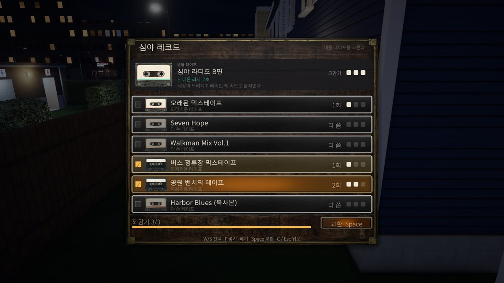 가게: 받을 테이프(위) → 내줄 테이프 고르기, 모은 횟수 막대 | 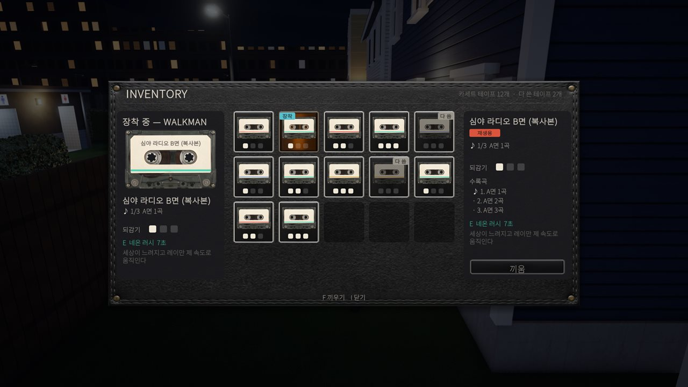 인벤토리: 가죽 테이프 가방, 테이프마다 횟수와 능력 |

### 4-3. 장르 테이프 능력 — R → Q/E 선택
1~5장을 직접 플레이해 보니 되감기를 한 번도 쓰지 않고 전투를 깰 수 있었습니다. 핵심 시스템이 전투에서 빠지지 않도록 테이프에 두 번째 쓰임을 붙였습니다.

장르가 있는 테이프로 **R**을 누르면 시간이 0.15배로 느려지고, 4초 안에 고릅니다. 화면에는 캐릭터 왼쪽에 "Q 되감기", 오른쪽에 "E 능력 이름(초)"만 뜹니다.
- **Q — 되감기**: 되돌린 5초마다 횟수 1회.
- **E — 장르 능력**: 횟수 1회.

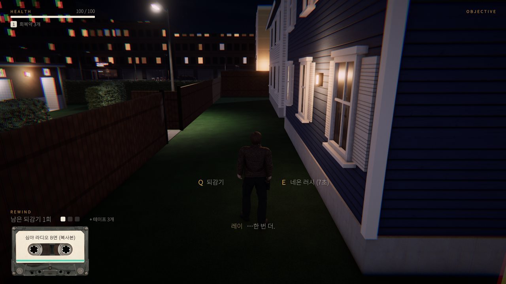
*장르 테이프로 R을 누르면 시간이 느려지고, 캐릭터 좌우에 두 가지 선택만 뜹니다.*

| 장르 | 능력 | 지속 | 효과 |
|---|---|---|---|
| 시티팝 | 네온 러시 | 7초 | 세상이 0.25배로 느려지고 레이만 제 속도(4배 보정) — 네온 잔상 |
| 재즈 | 즉흥 | 8초 | 구르기 무적 ×2, 반격 시간 ×1.6, 반격 피해 ×1.5, 구르기 거리 ×1.15 |
| 소울 | 그루브 | 8초 | 주먹 피해 ×1.5, 방패 경찰의 방패를 무시 |
| 앰비언트 | 고요 | 10초 | 받는 피해 ×0.5, 적을 쓰러뜨릴 때마다 체력 +8 |

| | |
|---|---|
| 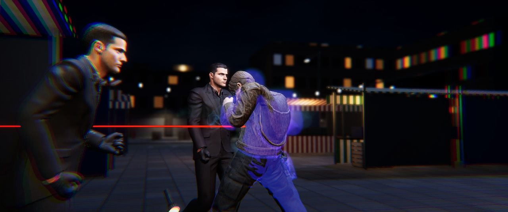 **시티팝 · 네온 러시** — 네온 잔상, 세상만 느려진다 | 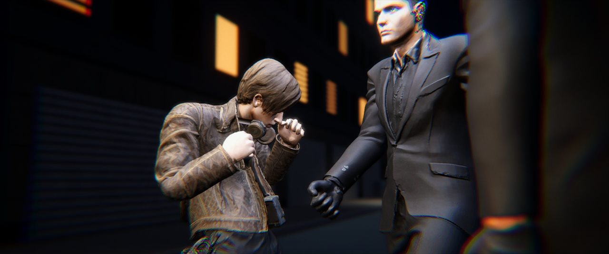 **재즈 · 즉흥** — 회피와 반격이 강해진다 |
| 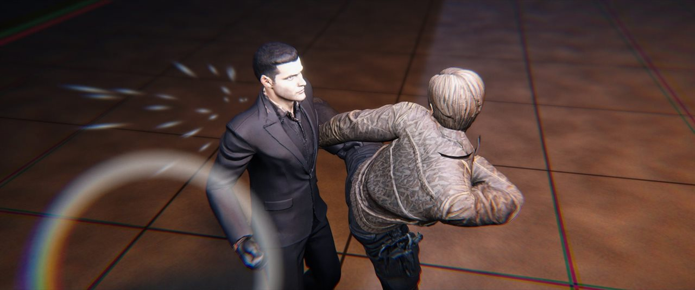 **소울 · 그루브** — 주먹이 세지고 방패를 뚫는다 | 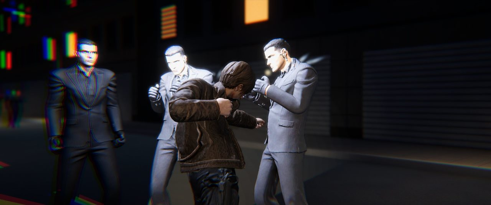 **앰비언트 · 고요** — 받는 피해 절반, 처치마다 회복 |

- 단순 속도 증가는 체감이 약해 배제하고, 시티팝은 '사이버펑크 엣지러너'의 산데비스탄 같은 시간 감속 연출로 만들었습니다.
- 장르는 음악 ID에서 정해집니다(`CassetteTape.GenreOf`). 그래서 이미 만들어진 장면도 다시 빌드하지 않고 바로 적용됩니다.

### 4-4. "레이만 기억한다" — 되감기의 보상
되감으면 세상은 되돌아가지만, 지워진 미래에서 일어난 일은 레이에게 정보로 남습니다(`RewindMemory`).

| 지워진 미래에서 | 되감은 뒤 레이가 얻는 것 |
|---|---|
| 순찰에게 들켰다 | 그 순찰의 손전등 시야가 12초 동안 바닥에 보인다(의심할수록 붉어진다) |
| 적에게 맞았다 | 그 적의 다음 공격 3번 동안 머리 위에 타이밍 막대가 뜨고, 완벽 회피 판정이 0.3초 → 0.45초로 넓어진다 |
| 처형기에 맞았다 | 그 적의 처형기가 다음부터 보라색으로 미리 보인다(되감아도 지워지지 않는 기억) |
| 되감기 직후 | **기억의 일격**: 3초 안에 처음 맞힌 주먹이 3배 피해(화면 글자는 처음 한 번만 띄운다) |

---

## 5. 전투

맨손 격투가 기본이고, 구르기 회피, 완벽 회피 반격, 몰래 제압이 있습니다.

| 행동 | 조작 | 수치 |
|---|---|---|
| 연속 공격 | 좌클릭 연타 | 잽 10 → 크로스 12 → 돌려차기 20 |
| 구르기 | 우클릭(방향 없으면 뒤로) | 3.8m, 0.64초, 무적 0.35초 |
| 완벽 회피 | 주먹이 닿기 직전 0.3초 안에 구르기 | 시간이 느려지고, 적이 1.2초 비틀거린다 |
| 회피 반격 | 완벽 회피 뒤 1.1초 안에 좌클릭 | 3배 피해(30), 7m 안의 적에게 달려든다 |
| 몰래 제압 | 눈치채지 못한 적의 등 뒤(1.7m, ±65°)에서 Q | 목 조르기로 한 번에 제압, 근처 적이 몰려오지 않음 |
| 회복약 | 1 | +25, 최대 5개, 되감아도 줄거나 늘지 않음 |

| | |
|---|---|
| 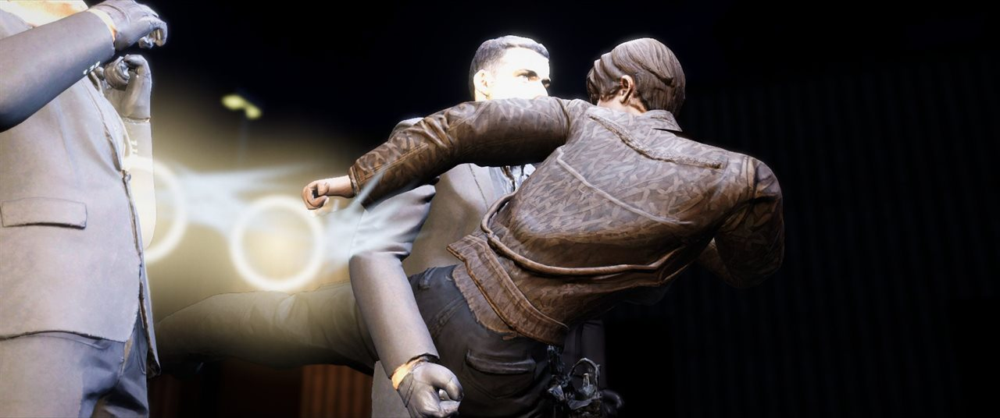 연타의 마지막, 돌려차기 | 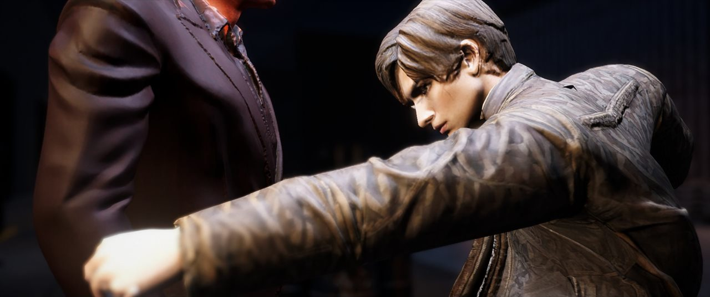 완벽 회피 뒤 반격 |

- **타격감(`HitFeel`)**: 약·중·강 3단계로 타격 정지(0.07/0.10/0.16초), 화면 흔들림, 시야각 반동을 주고, 마지막 적을 쓰러뜨리면 슬로모션과 테이프 늘어지는 소리가 납니다.
- **표정 (`FaceExpression`)**: 2~6초마다 깜빡이고(가끔 두 번), 싸울 때 미간을 찌푸리고 입을 다물고, 맞으면 0.7초 아파하고, 체력이 적으면 지친 얼굴, 되감을 때 눈을 질끈 감고, 레이 자막이 떠 있으면 입을 움직인다.
- **쓰러짐**: 적과 레이 모두 물리(래그돌)로 쓰러지고, 거의 멈추면 그 자세로 굳혀 목·몸이 달랑거리지 않게 합니다.
- **애니메이션**: 잽·크로스는 Quaternius(CC0), 돌려차기·피격은 Motifect 팩을 씁니다. 타격 순간이 팔다리가 가장 뻗은 프레임과 맞도록 재생 속도를 조정했습니다. 목 조르기 2인 동작은 Blender에서 두 캐릭터를 맞물려 직접 만들었습니다.

---

## 6. 잠입

| 요소 | 동작 |
|---|---|
| 손전등 순찰 (`PatrolSight`) | 앞쪽 11m · 반각 36° 부채꼴을 본다(일부 실내 순찰은 10m). 옆(정면 기준 100° 안)은 1.6m, 등 뒤는 0.6m 안으로 다가와야 알아챈다. 가까울수록 빨리 의심이 찬다(1.6m 약 0.45초, 11m 약 1.6초). 다 차면 "저기다!"와 함께 주변 순찰(기본 16m)이 몰려온다 |
| 탐조등 (`Searchlight`) | 반지름 4.2m 원이 경로를 훑는다. 원 안에 약 0.8초 있으면 경보가 울리고, 빛이 레이를 쫓는다 |
| 들켰을 때 (2·3장) | 시간이 느려지며 "R을 길게 눌러 되감는다"가 뜬다. 횟수가 없으면 붙잡혀 마지막 저장 지점으로 돌아간다 |
| 엄폐 | 덤불·건물·차 뒤에 있으면 보이지 않는다. 머리나 가슴 중 하나라도 트여 있으면 보인다 |
| 공정성 | 문을 여는 장면·컷신처럼 조작이 잠긴 순간에는 순찰이 의심하지 않는다 |
| 목격 | 동료가 목 졸리거나 방금(6초 안) 쓰러지는 것이 보이면(시야 +25°, 3.5m 안은 방향 무관 — 소리) 레이를 못 봤어도 바로 소리친다. 가려져 있으면 모른다 |
| 순찰 간격 | 순찰 둘이 붙어 다니지 않게 실제로 걷게 두고 잰다(`PatrolSpacingProbe`): 1~5장 모든 짝이 5m 안으로 붙지 않는다 |

| | |
|---|---|
| 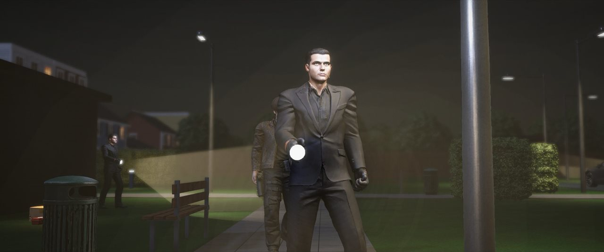 손전등 순찰 — 앞쪽 부채꼴만 본다 | 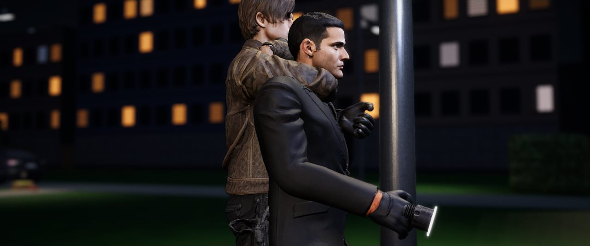 등 뒤에서 Q — 목 조르기 2인 동작(Blender 제작) |

---

## 7. 적 설계

| 유형 | 특징 |
|---|---|
| 조직원(근접) | 예고 동작 → 주먹. 3번째마다 **강타 "!!"**(붉은 예고, 20 피해) |
| 총잡이 | 붉은 조준선이 자라다 발사. 가려진 곳은 총알이 지나지 못한다. 5m 안으로 다가오면 물러선다 |
| 저격수 | 굵은 조준선. 1장은 2.2초 조준·45 피해, 4장은 2.0초·40 피해. 등 뒤가 보이지 않아 몰래 다가가 제압할 수 있다 |
| 방패 경찰 | 정면 ±70°로 들어오는 18 미만 피해를 막는다. 잽·크로스는 막히고 돌려차기는 방패를 쳐낸다. 정면으로 두 번 막으면 밀쳐낸다 |
| 실험체 | 3·5장의 강화된 적 |
| **처형기 "!!!"** (2~5장 보스) | 0.3초 만에 나가는 큰 공격(40~50 피해). 처음에는 예고가 없어 피하기 어렵고, 한 번 맞으면 레이가 기억해 다음부터 보라색 예고가 보인다. 2장 부반장(40)·3장 옛 파트너(42)·4장 옛 파트너(45)·5장 0번(50)이 3~4번째 공격마다 쓴다. 1장 보스는 쓰지 않는다 |
| 1장 보스 정리반 반장 | 3단계: 근접 → (60%) "애들아! 나와!" 권총·엄폐 + 숨어 있던 부하 둘 → (25%) "너한테 넘기느니 태워 버린다!" 대니의 테이프를 태우러 달려감(위에서 '그대로 가져오라'는 명령이라 그전엔 안 태웠다) → 되감아서 막는다 → 막으면 남은 체력으로 끝까지 맞선다(다 깎아야 마무리). 큰 한 방에도 60% · 25%에서 멈춰 단계를 건너뛰지 않는다. 권총은 30m까지 쏘고, 첫 소각 달리기는 막을 수 없는 짧은 컷신이라 반드시 되감아서 막게 된다 |

- **장면 전 체력 바닥(`Health.floor`)**: 큰 한 방(기억의 일격 3배 등)으로 보스가 연출 전에 쓰러져 소각 장면·도주 장면이 통째로 건너뛰어지던 문제를 막습니다(반장 25%, 3장 파트너 40%, 4장 파트너 60%·40%).

| | |
|---|---|
| 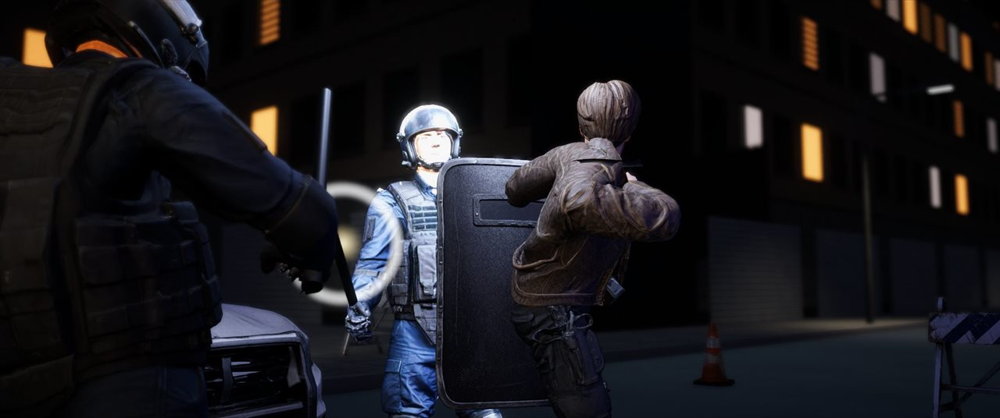 방패 경찰 — 잽·크로스는 막히고 돌려차기가 쳐낸다 | 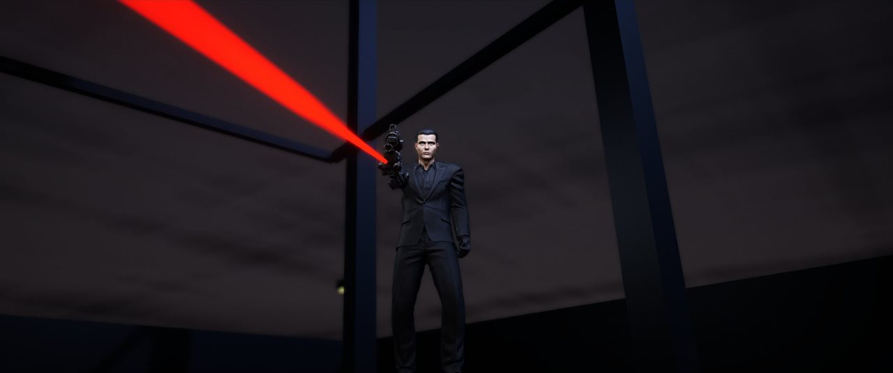 4장 저격수 — 굵은 붉은 조준선 |
| 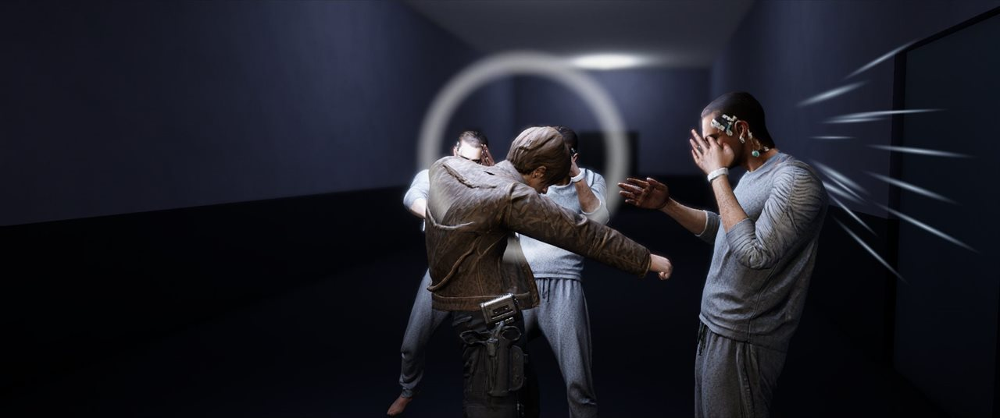 3장 실험체 | 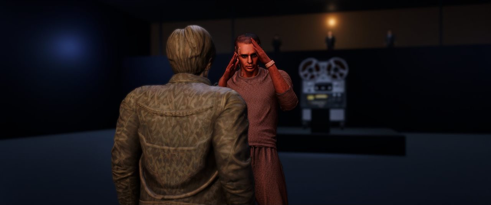 5장 보스 실험체 0번, 유리 관람석의 윗선 |

---

## 8. UI·UX

- **공통 꾸밈 (`UiTheme`)**: Noto Sans KR 글꼴, 호박색 강조, 작은 영문 표제(PAUSED · SETTINGS · HEALTH · OBJECTIVE · REWIND), 키 모양 안내([F] [Q] [1]). 일시정지·설정·HUD·인벤토리·가게·튜토리얼·비밀번호 패널·타이틀이 같은 규칙을 씁니다.
- **카세트 누아르 겉감 (10-17)**: 창마다 무대에 맞는 물건을 씁니다.
  - 일시정지 · 설정 · 튜토리얼 · 비밀번호 패널: 80년대 카세트 덱의 브러시드 알루미늄 앞판(네 귀퉁이 나사)
  - 인벤토리: 박음질과 놋쇠 리벳이 있는 가죽 테이프 가방
  - 가게: 놋쇠 테두리를 두른 레코드 가게 나무 계산대
  - 단추 · 목록 줄: 은색 테두리의 하이파이 덱 누름 단추, 고르면 안에서 호박빛이 켜진다(그 위 글씨는 따뜻한 흰색)
  - 카세트: 반투명 회색 껍데기 + 크림색 라벨(가게 테이프), 검은 무지 테이프(주운 테이프). 재생 중에는 릴 허브가 돌고, 라벨 줄무늬가 장르 색으로 바뀐다
  - 모두 VARCO 이미지 생성(초록 배경 촬영 → `UiArtBuilder`로 배경 제거 · 자르기)으로 만들고, `UiTheme.Nine`이 모서리는 그대로 두고 가운데만 늘여 그린다. 조각 경계는 화면 픽셀에 맞춰 틈 선이 생기지 않게 한다. 글자 뒤에는 무늬를 깔지 않는다
- **HUD**: 체력, 회복약, 목표, 길잡이, 카세트 위젯(지금 R에 쓰일 횟수와 예비 테이프 수), 적 체력·예고(!!, !!!, 기억 막대), 순찰 의심(?·!), 주울 테이프 표시, 자막, 알림.
- **화면 글자 최소화**: 조작 안내는 상시 표시하지 않고 Esc → 조작법에 둡니다. 알림은 오른쪽 아래에 작게 띄웁니다.
- **튜토리얼 12종**: 처음 필요한 순간에 작은 알림("H 보기")이 뜨고, H를 누르면 쪽 넘김 설명(강조 글씨, 그림)이 열립니다. 한 번 본 설명은 다시 뜨지 않고(저장), **Esc → 튜토리얼**에서 언제든 다시 볼 수 있습니다. 프롤로그에서 편지 뒷면을 읽기 전에는 아무 설명도 띄우지 않습니다.
- **일시정지 메뉴**: 계속하기 · 설정 · 조작법 · 튜토리얼 · 타이틀로 · 게임 종료.
  - 설정은 탭 셋입니다. 소리(전체·음악·효과음) / 화면(화면 모드·해상도·화질·프레임 제한) / 조작(마우스 감도·상하 반전). Q/E로 탭을 옮깁니다.
  - 싸우다 연타한 클릭이 메뉴를 잘못 고르지 않도록, 결정은 Enter로만 받고 마우스는 실제로 움직인 뒤에만 받습니다. 누를 수 없는 글자는 마우스를 올려도 변하지 않습니다.
- **타이틀**: 카세트 데크 모양의 메뉴(재생·되감기·빨리 감기·정지)와 이어하기/새로 시작.
- **컷신 건너뛰기**: Space를 1.2초 누르면 됩니다(오른쪽 아래 원형 게이지).
- **가게**: 두 단계(받을 테이프 → 내줄 테이프)로 바꾸며, 모은 횟수가 막대로 보이고 남는 횟수는 사라진다고 미리 알려 줍니다.
- **비밀번호 패널**: 숫자 키나 마우스로 직접 입력합니다. 틀리면 빨갛게 깜빡이고 지워지며, 번호를 모를 때는 닫았다가 언제든 다시 열 수 있습니다.

| | |
|---|---|
| 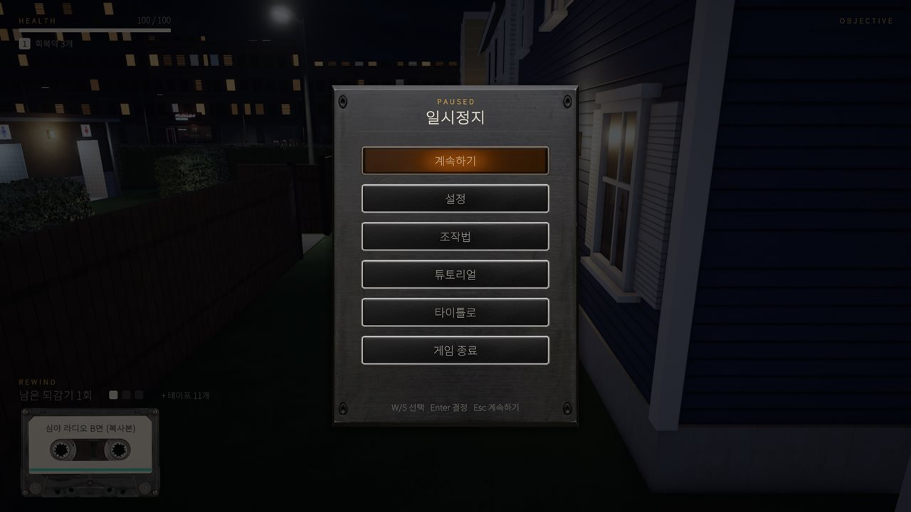 일시정지 — 카세트 덱 앞판, 덱 누름 단추 | 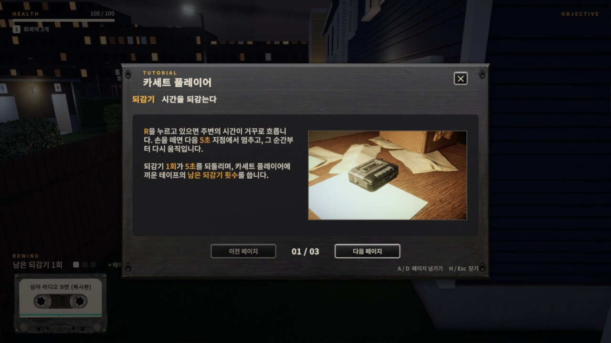 튜토리얼 — 쪽 넘김 설명과 그림 |

---

## 9. 기술 구현

### 9-1. 되감기 아키텍처
되감기는 외부 에셋 없이 직접 만들었습니다([`TimeRewind.cs`](../Assets/Game/Scripts/Core/TimeRewind.cs)).
- **`TimeRewind`**: 실제 시간(unscaled) 기준으로 초당 20번 세상 상태를 찍어 16초를 보관하고, 스냅샷 객체는 재사용합니다. 히트스톱·슬로모션이 "5초" 되감기를 짧게 만들지 않고, 메뉴·사망 화면의 시간은 기록하지 않습니다.
- **`IRewindable`** 인터페이스(`CaptureState` / `RestoreState(state, preview)`)로 상태를 저장·복원합니다.
  - 구현 대상 13개: 체력, 플레이어(자세·애니메이터), 적, 순찰 시야, 방패 경찰, 보스, 증거물 담당, 실험 부스, 탐조등, 전투 구역, 구역 관문, 들기 자세, 게임 진행(`GameManager`).
  - 거꾸로 재생하는 동안은 가벼운 시각 갱신만(`preview = true`), 멈춘 순간에 한 번 정확히 복원합니다.
- **되감지 않는 것**을 명시적으로 나눴습니다.
  - 인벤토리·테이프·회복약, 주운 물건, 가게 교환, 레이의 기억(`RewindMemory`, `KnownExecute`), 저장 지점, 이미 울린 경보.
  - 이 구분이 "레이만 기억한다"를 시스템으로 만듭니다.
- **이야기 시계 (`StoryState.Now`)**: 연출의 기다림·자막은 메뉴가 열리면 멈추는 별도 시계를 씁니다. 연출 중에 일시정지해도 대사가 흘러가지 않습니다.
- **연출용 긴 되감기** (프롤로그, 4장): 기록을 미리보기로 거꾸로 재생(`TimeRewind.Preview`)한 뒤 `RewindTo` → `Clear`로 마무리합니다.

### 9-2. 코드로 만드는 장면
- 프롤로그와 1~5장은 모두 **에디터 빌더 스크립트**(`PrologueBuilder`, `Chapter1Builder`를 장·구역별 9개 파일로 나눈 partial class)가 처음부터 만듭니다. 지형, 건물, 조명, 소품, 적·순찰 경로, 트리거, 내비메시, 감독(Director) 연결까지 포함합니다.
- **장점**: 레이아웃·밸런스를 코드로 바꾸고 다시 빌드할 수 있고, 장면 파일 충돌이 없습니다.
  - 예: 모든 장의 비를 한 번에 제거, 장면 전체 밝기 조정(`BrightnessPass`), 작은 물체 그림자 일괄 정리.
  - 맵 줄이기: 구역을 원래 자리에 지은 뒤 그 뒤쪽 전체를 통째로 당깁니다(`ShiftNew`). 길·순찰 경로·트리거가 함께 움직여 어긋나지 않습니다.
- **이야기 감독**: 장마다 `ChapterNDirector`가 코루틴으로 단계(Phase)를 진행합니다. 목표, 길잡이, 자막, 컷신 카메라(Cinemachine), 저장 지점을 관리합니다.
- **상호작용 (`StoryInteractable`)**: F로 쓰는 문·장치는 기본이 "한 번만"입니다. 처리하는 쪽이 "지금은 안 된다"(싸우는 중, 아직 때가 아님)고 판단하면 `Refuse()`를 불러 그 누름을 소모하지 않습니다. 이 규칙이 없을 때는 막힌 채 한 번 누르면 문이 영영 꺼져 진행이 멈췄습니다(2장 뒷문·비밀번호 문, 5장 리프트 등).
- **저장**: `save.json`(persistentDataPath)에 장·저장 지점·테이프·회복약·주운 물건·가게 교환 기록을 씁니다. 에디터는 같은 폴더를 쓰므로 `save_editor.json`을 따로 쓰고, 새 게임은 예전 저장을 지우고 첫 장면부터 새로 기록합니다. 저장 형식에 판 번호를 붙여 고치기 전의 파일은 '이어하기'에 나오지 않습니다. 저장하는 순간의 적·교전 구역 상태는 메모리에 기억해 두었다가, 쓰러져 다시 시작하면 저장 뒤에 쓰러뜨린 적만 되살립니다. 타이틀에서 시작한 게임만 저장해서, 시험·자동 플레이는 실제 저장을 덮어쓰지 않습니다.

### 9-3. 글자가 넘치지 않는 IMGUI (`UIText`)
- 모든 글자는 `UIText`를 거칩니다.
  - 칸보다 길면 글자 크기를 0.93배씩 줄입니다(최소 9px).
  - 한 줄 칸은 줄바꿈 없이 폭에 맞추고, 그래도 넘치면 '…'로 줄입니다.
- **화면 배율** = min(세로/1080, 가로/1920)이되, 가장 큰 창이 화면에 들어가는 만큼(세로 760 · 가로 1350 기준)까지는 키웁니다. 에디터의 작은 게임 창(1000×400)에서 글자가 7px까지 줄어 줄끼리 겹치던 문제를 막습니다. 창(인벤토리 · 가게)이 열린 동안은 위쪽 상태 표시와 자막을 숨기고, 보스 체력 막대가 있으면 자막을 그 위로 올립니다.
- **그림자**: 서식 색 태그를 뺀 글자로 그립니다. 전에는 화자 이름이 금색으로 두 번 찍혀 보였습니다.
- **마우스 올림 번짐 막기**: 유니티 글자 칸은 마우스가 올라가면 '올림' 상태 색으로 그려, 그림자까지 밝게 찍혀 글자가 두 겹으로 보였습니다. 모든 상태 색을 같게 맞춥니다.
- **잰 결과 기억**: 유니티는 글자를 재거나 그릴 때마다 68바이트씩 새로 잡습니다. 같은 글자 · 같은 칸 · 같은 글자 모양이면 지난번 맞춘 크기를 그대로 쓰고, 색 태그를 뺀 글자도 기억합니다(HUD 할당 −34%).
- **검사용 기록 모드**: 그린 글자가 실제로 차지한 영역을 기록해 자동 검사(→ [11](#11-품질-검증-체계))에 씁니다.

### 9-4. 렌더링
- URP Forward+, HDR, TAA, SSAO, Linear 색 공간, 수직동기화.
- **바다**: 카메라를 따라다니는 동심원 격자에 거스트너 파도 4겹을 얹습니다(Burst 병렬 잡, 해석적 노멀).
- **하늘**: 그라디언트·구름·스카이라인 스카이박스. 1장 엔딩에서 밤에서 새벽으로 바뀝니다(`SkyCycle`).
- **되감기 화면 효과**: 볼륨 가중치와 테이프 잡음 줄, VARCO로 만든 테이프 감기·멈춤 소리.

---

## 10. 에셋 제작 파이프라인

| 분야 | 도구 | 결과 |
|---|---|---|
| 캐릭터 3D | VARCO 3D (이미지 생성 → 3D 생성 → 자동 리깅) | 10명 (레이, 대니, 조직원, 방패 경찰, 정리반, 경찰, 옛 파트너, 실험체, 회장, 국회의원) |
| 소품 3D | VARCO 3D | 63종 GLB → 실측 크기·바닥 피벗·충돌체 프리팹 자동 생성(`BaroquePropSetup`) |
| 건물 | 코드 (절차 생성 `HouseBuilder`) | 이미지→3D 건물은 창틀이 녹고 텍스처가 번져서 버림 |
| 주인공 얼굴 | Blender (MCP로 조작) + 코드 (`FaceRig`) | 텍스처 31조각에 흩어진 얼굴(약 190×190px)을 한 조각으로 다시 펼쳐 2048 얼굴 텍스처로 굽고 조각 경계 자국을 메움. 표정 모양 8개(깜빡임 좌우 · 찌푸림 · 눈썹 안쪽 올림 · 눈 찡그림 · 입꼬리 내림 · 입 다묾 · 입 벌림)와 눈꺼풀을 만들어 유니티 메시에 블렌드셰이프로 더함 |
| 손가락 | 코드 (`FingerRig`) | VARCO 리그에 손가락 뼈가 없어 손 정점을 손가락으로 나누고 뼈를 자동 생성. 싸울 때 주먹을 쥔다 |
| 2인 동작 | Blender (MCP로 조작) | 목 조르기 2인 동작, 손전등·방패 들기 자세, 헤드폰, 화물선 |
| 전투 동작 | Quaternius UAL1 (CC0), Motifect | 잽·크로스·구르기, 돌려차기·피격 |
| 효과음 | VARCO Sound → `SfxTool` (구간 자르기·스펙트로그램·파형 확인·루프) | 타격·휘두름·신음 30개, 회복약 2개, 환경음 13개 |
| 음악 | VARCO Sound | 가게 테이프 10종 26곡, 타이틀 3곡 |
| 타이틀 그림 | VARCO 워크플로의 이미지 생성(nano-banana-2) | 배경·로고 (실제 상표가 보이는 후보는 제외) |
| UI 그림 | VARCO 이미지 생성 → `UiArtBuilder` | 카세트 2종(허브 따로 오림), 창 겉감 3종, 덱 단추(평소 · 켜짐) |
| 글꼴 | Noto Sans KR (SIL OFL) | 게임 전체 글자 |

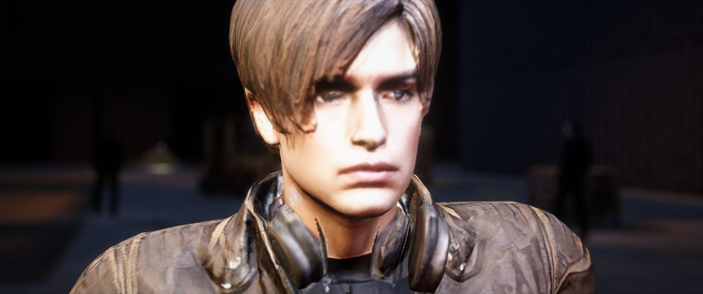
*Blender에서 한 장으로 다시 구운 레이의 얼굴(표정 블렌드셰이프 · 깜빡임 포함).*

### 품질 관문 (검수에서 생긴 규칙)
- 생성 에셋은 **플레이어 거리(2~6m)에서 네 방향과 45°**로 렌더해 확인하고, 녹은 형상·번진 텍스처·구멍이 있으면 쓰지 않습니다. "가리면 된다"는 통과가 아닙니다.
- **시대 확인**: 사무실·경찰서 소품이 1990년대풍으로 낡아 보이는 문제가 있어, 생성 단계부터 '현대·깨끗함·사용 중'을 요청하고 후보를 시대·상태·분위기로 먼저 거릅니다.
- 소품 후보는 실측 크기와 밤거리 조명 아래에서 1.8m 사람과 함께 5방향으로 비교했습니다(`PropCandidateQA`).

---

## 11. 품질 검증 체계

에디터 도구 57개 가운데 시험·검증 도구가 약 절반입니다.

### 플레이 모드 자동 시험 (21종)
- **흐름 (6)**: 프롤로그 전체, 1장 구역 1~2(구역 3은 보스 시험), 2~5장 각 장 전체(5장은 엔딩 두 가지 모두 크레딧까지)
- **시스템 (13)**: 보스 단계, 전투(강타·완벽 회피·방패), 전투 동작 타이밍, 반격, 되감기 기억, 처형기·기억의 일격, 구르기, 장르 능력, 저장/이어하기(1장 저장 지점 4곳), 일시정지, 컷신 건너뛰기, 타이틀 데크, 타격감
- **회귀 (1)**: 플레이 검수에서 찾은 버그 6개의 재발 검사(`BugFixTest`)
- **시험의 한계**: 장 시험은 F 상호작용을 "누른 것과 같게" 직접 불러서, 실제 키 입력이 막히는 버그(→ 9-2 `Refuse`)는 잡지 못했습니다. 2~5장의 저장/이어하기도 장 시험 안에서 일부만 확인합니다.

### 자동 플레이 봇 (`PlaytestBot`)
- 순간이동 없이 **실제 키·마우스 입력만으로** 타이틀부터 플레이합니다.
- 기록: 컷신과 직접 조작 시간 비율, 가장 긴 '아무 일 없는 걷기', 쓰러짐, 되감기, 피해, 처치.
- 잠입 구간용으로 순찰·탐조등 위치를 몇 초 앞까지 예측해, 안전할 때만 움직이고 시야를 피해 돌아가는 판단을 넣었습니다.
- 주행 기록(10-13): 타이틀에서 출발해 11분 12초에 2장 도착, 쓰러짐 8회(그중 4회가 1장 보스) → 보스 난이도 검토 자료로 사용.

### 맵 크기 검사 (교차검증)
- 걸을 수 있는 땅 가운데 12m 안에 아무것도 없는 곳(빈 바닥)과 걷는 길이를 재고, 별도 에이전트의 코드 검토와 맞춰 봅니다. 두 방법이 같은 곳을 지목하면 줄이거나 막습니다(→ [13](#13-개발-과정과-의사결정)).

### UI 글자 검사 (`UiLayoutTest`)
- **해상도 8종**(2560×1080, 1920×1080, 1366×768, 1280×1024, 1280×720, 1024×768, 800×600, 에디터의 작은 게임 창 1000×400) × **화면 40종**(플레이 중 겹침 최대 상황, 선택지, 능력, 보스, 컷신, 편지, 인벤토리, 가게 두 단계, 일시정지 7쪽(설정 탭 셋 포함), 튜토리얼 모든 쪽, 비밀번호 패널)을 띄웁니다.
- 글자끼리 겹침, 2중, 칸 넘침, 화면 밖, 크게 줄어듦, 잘림을 자동으로 재고 스크린샷을 남깁니다.
- **결과**: 실제 문제 336건 → 수정 후 0건. 첫 실행의 4,068건은 검사기가 같은 글자를 두 프레임에 걸쳐 센 중복 집계를 포함한 수치였습니다. 남은 5건은 알림이 미끄러져 들어오는 중의 정상 동작입니다. UI를 새로 칠한 뒤(10-14, 10-17)에도 0건을 유지합니다.
- 검사기가 못 보는 글자-막대 겹침은 스크린샷을 직접 확인해 따로 고쳤습니다.

### 순찰 간격 검사 (`PatrolSpacingProbe`)
- 장마다 순찰을 실제로 4배속으로 걷게 두고, 둘이 3.5m 안에 붙어 있는 시간 비율과 가장 가까운 거리를 짝마다 잽니다. 1장 야적장 0.6m · 공원 1.4m · 3장 하역장 2.6m까지 붙던 짝을 고쳐, 지금은 모든 짝이 5m 넘게 떨어집니다.

### 시각 검증 도구
- `FilmMaker`(유튜브 트레일러: 음악 박자에 맞춘 컷, 인물에 붙는 영화식 카메라 · 얕은 심도, 아래 띠 설명 · 조작 키 · 능력 이름, 게임 소리 + 음악을 MP4로. 이 문서의 장면 사진도 이 도구로 뽑았습니다), `TrailerMaker`(플레이 영상 녹화: 게임 카메라와 게임 소리 그대로 MP4로), `FaceShots`(주인공 표정 다섯 가지를 한 장에), `QaShots`(지정 위치·방향 렌더와 그리드), `PoseSheet`(애니메이션 자세 시트), `PropCandidateQA`, `MusicQA`(음악 후보의 음량·클리핑·끊김·템포·보컬 대역 분석).

---

## 12. 최적화

### 12-1. 측정 도구
- **`PerfProbe`(에디터)**: 장면마다 프레임·메인 스레드·GPU·GC 할당·Batches·삼각형·그림자 물체를 재고, 프로파일러에서 자기 시간과 할당 상위 함수를 뽑습니다.
- **`Benchmark`(빌드)**: 실행 파일에 `-benchmark`를 붙이면 장면을 차례로 재서 `benchmark.txt`를 남깁니다. `-profile`(개발 빌드)이면 프로파일러 기록을 파일로 남기고, `PerfProbe.AnalyzeRaw`로 가장 느린 프레임을 분석합니다.

### 12-2. 무엇을 고쳤나
| 문제 (측정으로 찾음) | 해결 | 결과 |
|---|---|---|
| 1장 바다가 매 프레임 정점 5,856개를 메인 스레드에서 계산하고, 법선을 다시 구하고, 47KB 배열을 새로 만듦 | Burst 병렬 잡, 거스트너 식으로 노멀 직접 계산, 배열 재사용, 안 보이면 건너뜀 | 3.2ms → 0.05ms |
| VARCO 소품이 하나에 1~5만 삼각형, 수십 개씩 반복 | Unity 메시 LOD 자동 생성(최대 6단계, `PropLods`)을 프리팹에 적용 | 화면 삼각형 2장 1,336만 → 628만, 1장 755만 → 525만, 3장 561만 → 260만 |
| glTFast로 들어온 GLB 텍스처가 압축 없이 올라감(149장) | PNG로 꺼내 BC7 압축, 소품 크기별 최대 크기 제한(512/1024/2048, `PropTextures`) | 텍스처 메모리 약 3.7GB → 530MB (에디터 측정) |
| 화면 밖 적도 매 프레임 스키닝·뼈 계산 | 화면 밖 애니메이션 생략(`CullUpdateTransforms`), 넉넉한 경계 상자 | — |
| 작은 물체 그림자 | 대각선 0.8m 미만은 그림자 끔(빌더 공통 단계) | 1장 317개, 프롤로그 62개, 2장 35개 등 |
| 매 프레임 같은 글자 문자열 생성, 목록 복사(`FindAll`) | 값이 바뀔 때만 생성, 직접 세기 | GC 할당 감소 |
| 새 UI 뒤 글자 칸이 늘며 GC가 장마다 3~5회 늘어남 | 프로파일러로 추적: 유니티가 글자 칸 하나를 재거나 그릴 때마다 68바이트. `UIText` 잰 결과 기억, 색 태그 뺀 글자 기억 | HUD 2.6KB → 1.7KB/프레임, 빌드 GC 13~18회 → 8~14회 |
| 쓰지 않는 Opaque Texture | 끄기 | — |
| 편집기에서 플레이하면 수직동기화가 무시돼 제한 없이 돌며 CPU 과열 | "모니터에 맞춤"이면 모니터 주사율을 목표 프레임으로도 건다 | 편집기 CPU 38% → 13%(60fps), 빌드는 원래 3% |
| 편집기 플레이 중 팬 소음 | 같은 1장·같은 60fps로 빌드와 비교(`Benchmark -capped -only Chapter1`): 편집기 CPU 42% · 그래픽카드 약 92W · 팬 45~57%, 출시 빌드 CPU 9.5% · 55~65W · 팬 0%. 게임 한 프레임 일은 4.5ms로 같고, 나머지는 편집기 창(장면 창·인스펙터 등) 비용 | 실제 게임에서는 생기지 않음 |
| 장 넘어갈 때 동기 로딩으로 몇 초간 게임 전체가 멈춤 | 비동기 로딩(`SceneLoader`): 검은 화면 뒤에서 불러오고, 이전 장면은 시간·조작을 잠금 | 소리 끊김·응답 없음 해소 |
| 효과음·발소리가 소리마다 오브젝트를 만들고 지움(걷는 사람마다 한 걸음에 하나) | 오디오 소스 32개 풀을 돌려 씀 | 생성·파괴 제거 |
| 같은 높이로 겹친 면이 깜빡임(z-fighting, 예: 2장 1층 벽 윗면 = 2층 바닥면), 바닥에 깔린 얇은 선의 그림자가 톱니처럼 번쩍임 | 겹친 윗면 중 작은 쪽을 1.2cm 낮춤, 바닥 위 얇은 판은 그림자 끔(빌더 공통 단계 + 기존 장면 적용) | 겹친 윗면 0개(6장면, 낮춘 상자 513개), 바닥 위 얇은 판 그림자 567개 끔 |

※ '이전' 수치는 같은 측정 도구(PerfProbe)로 고치기 전에 잰 값입니다. 측정 기록 파일은 다시 잴 때 덮어써져, 지금 저장소에는 '이후' 기록만 남아 있습니다. 삼각형 수는 측정 시점 화면에 그려진 수입니다.

### 12-3. 결과
**에디터(1920×1080) 1장 프레임**: 15.3ms → 10.0ms. GC 할당 71KB → 약 22KB/프레임. 에디터 수치에는 에디터 자체 비용(장면마다 약 4~5ms)이 포함됩니다.

**출시 빌드** (RTX 3070 · i5-11400F · 1920×1080 · 프레임 제한을 풀고 측정, 10-14 최종):

| 장면 | 평균 | 99% 프레임 | 최악 프레임 | GPU | GC |
|---|---|---|---|---|---|
| 프롤로그 | 2.0ms (502fps) | 2.8ms | 12.6ms | 1.8ms | 14회 |
| 1장 | 3.0ms (339fps) | 3.8ms | 8.0ms | 2.5ms | 12회 |
| 2장 | 2.7ms (371fps) | 3.4ms | 4.2ms | 2.4ms | 8회 |
| 3장 | 2.2ms (454fps) | 3.1ms | 3.5ms | 1.5ms | 11회 |
| 4장 | 2.9ms (349fps) | 3.5ms | 4.1ms | 2.6ms | 8회 |
| 5장 | 1.9ms (518fps) | 2.7ms | 8.4ms | 1.6ms | 12회 |

- 10-13 첫 빌드 측정(1장 278fps, 최악 프레임 101ms)보다 모든 장면이 빨라졌고, **최악 프레임도 60fps 한 프레임(16.7ms) 안**입니다.
- 새 UI(둥근 판·그림자·글자 칸 증가)를 넣은 뒤에도 평균은 같은 수준이고, GC는 UI를 바꾸기 전(9~14회)보다 적습니다.
- 실제 플레이는 모니터 주사율(수직동기화)에 묶여 돌며, 타이틀에서 CPU 약 3%입니다.

### 12-4. 순간 끊김 분석
- 빌드에서 프롤로그·1·2·5장에 한 번씩 **50~114ms 끊김**이 있었습니다(3·4장의 최악은 31·25ms). 개발 빌드 프로파일로 이 네 장면의 가장 느린 프레임을 분석하니, 원인은 모두 **한글 글자를 처음 쓸 때 글꼴이 글자 모양과 간격 정보를 만드는 비용**이었습니다(`GlyphRasterizer`, `GetPairAdjustmentRecords`). 처음 실행되는 함수의 JIT 비용(약 8~12ms)도 함께 있었습니다.
- **해결**:
  - 게임 코드에 나오는 글자 1,082자를 목록으로 만들었습니다(`GameChars`).
  - 시작할 때 몇 프레임에 나눠 보통·굵은 글씨, 줄바꿈·색 태그가 있는 배치로 미리 그려 둡니다(`FontWarmup`). 프롤로그 첫 자막의 21.2ms도 이것으로 내렸습니다.
- **검증** (같은 개발 빌드·같은 측정 방식, 장면마다 8초의 최악 프레임):

| 장면 | 전 | 후 |
|---|---|---|
| 프롤로그 | 101.8ms | 11.8ms |
| 1장 | 113.7ms | 17.9ms |
| 2장 | 65.6ms | 13.0ms |
| 5장 | 49.6ms | 8.0ms |
| 3장 · 4장 | 31.6 · 31.7ms | 33.3 · 32.2ms → 다음 측정에서는 재현되지 않음(9.9 · 14.2ms), 최종 빌드 3.5 · 4.1ms |

---

## 13. 개발 과정과 의사결정

### 타임라인 (커밋 기준)
| 날짜 | 커밋 | 내용 |
|---|---|---|
| 09-30 | — | 판타지 지형 프로토타입(Stage01)으로 시작 → 같은 날 '카세트 되감기' 이야기를 받고 현대 도시로 전환 |
| 10-02 | `5a46078` | 첫 업로드: 프롤로그, 1장 「B면」 구역 1 |
| 10-06 | `3aabbef` | 코드로 합성하던 효과음을 VARCO Sound 녹음으로 교체 |
| 10-06 | `909ae0b` | 전체 검토에서 찾은 버그 수정 |
| 10-06 | `d29a1bf` | 빌드 장면 목록, 출처 기록, .gitignore 정리 |
| 10-06 | `4347d9a` | 1장 구역 2 시장 광장, Q 몰래 제압 |
| 10-08 | `2d6a396` | 1장 구역 3 항구, 보스, 엔딩. 되감기 기억, 반격, 목 조르기, 타이틀, 일시정지 |
| 10-13 | `b01c8f2` | 2~5장과 종장, 장르 능력, 글자 검증, 전체 최적화 |
| 10-14 | `6efe75e` | 5장 주차장 축소(60×60m → 36×40m), 글꼴 예열, 이 문서 |
| 10-14 | `77fc901` | 전 장 맵 줄이기·틈 막기, 다시 시작할 때 적 되살리기, 보스 한 방 버그, 쓰러짐 흔들림, 비동기 로딩, 소리 풀 |
| 10-14 | `bba0da7` | UI 새 꾸밈(Noto Sans KR), 설정 탭, 테이프 규칙 단순화, 상호작용 막힘 버그(`StoryInteractable.Refuse`), 2장 기록실 축소 |
| 10-14 | `2c14eac` | 편집기 플레이 CPU 과열(프레임 제한), HUD 글자 GC 줄이기 |
| 10-16 | `9d5b1ed` | 주인공 얼굴 다시 굽기 · 표정 8개 · 깜빡임, 순찰 목격 · 간격, 1장 보스 단계 · 컷신 건너뛰기 버그, 2장 보관소 · 5장 장비실 축소, 대사 정리 |
| 10-16 | `c6d24bb` | 전체 점검(시험 21개 + 코드 검토로 찾은 버그 7개), 피격 밀림 줄이기 |
| 10-17 | `52c37b5` | 카세트 누아르 UI 겉감(VARCO), 실제 카세트 그림, 가게 두 단계 교환, 네온 러시 7초, 반격 3배, 반장 사격 거리 · 소각 컷신, 작은 창 글자 겹침 |
| 10-19 | `77bf172` | 플레이 트레일러 녹화 도구, Windows 빌드 |
| 10-19 | `ffe1118` · `28b3e85` | 설명을 넣은 유튜브 트레일러(`FilmMaker`), 새 게임이 예전 저장을 덮고 에디터 저장을 분리(빌드 '이어하기'가 2장부터 시작하던 문제) |

### 플레이 검수로 바뀐 설계
직접 플레이하며 찾은 문제와 바꾼 것을 정리했습니다. 성능 문제는 [12-2](#12-2-무엇을-고쳤나)에 있습니다.

**재미·시스템**
| 문제 | 바꾼 것 |
|---|---|
| 되감기를 쓰지 않고도 전투를 깰 수 있음 | 장르 능력(R → Q/E), 기억의 일격, 처형기 |
| 되감기 잔상 · 미끼 연출이 전투에 도움이 되지 않음 | "레이만 기억한다" 원칙 → 시야 기억, 타이밍 막대, 처형기 기억 |
| 되감기 재생이 너무 빠름 | 10배 → 4배 |
| 빈 테이프가 있는데 가게에서 교환이 안 됨 · 테이프 충전이 헷갈림 | 듣는다고 다시 차지 않고, 노래는 끊기지 않으며, 횟수 0이면 바로 교환하는 단순한 규칙(→ [4-2](#4-2-테이프)) |
| 손으로 키를 잡은 구르기 동작이 부자연스러움 | 모션캡처 구르기에 코드로 타이밍 동기화 |
| 2장 비밀번호 퍼즐이 진행을 오래 막음 | 담당이 누르는 번호를 엿보고 직접 입력하는 패널, 안의 담당은 제압·전투 |
| 회피 반격이 너무 셈 | 반격 피해 3.5배 → 3배 |
| 네온 러시가 너무 짧음 | 4초 → 7초 |
| 남은 되감기용 테이프를 쓸 곳이 없음 | 되감기용 테이프 횟수 합 3회로도 능력 테이프와 교환(가게 두 단계) |
| 되감을 때마다 같은 "기억의 일격" 글자가 반복돼 화면이 복잡함 | 처음 한 번만 띄운다(효과는 그대로) |
| 6장 + 종장 구성이 길다 | 5장으로 압축 (윗선과 본사 장을 30주년 방송 밤으로 합침) |

**맵 크기** — 걷기만 하는 빈 공간이 가장 자주 나온 문제였습니다. 빈 바닥과 걷는 길이를 재고 교차검증으로 확인한 뒤 줄였습니다.
| 곳 | 전 → 후 |
|---|---|
| 프롤로그 레이 집 → 대니 집 | 107m → 53m |
| 1장 | 항구 부두 마당 148×106m → 102×72m, 큰길 −30m, 광장~항구 문 −20m, 광장 동쪽 76 → 66m, 공원 서쪽 빈 잔디·큰길 남쪽 막다른 길 정리 |
| 2장 | 골목 −12m, 뒷길 156 → 66m, 보관소 130 → 94m, 깊이 86 → 70m(차 줄 간격 14 → 10m), 경찰서 기록실 18×10 → 10×6.6m |
| 3장 | 시작 길 120 → 80m, 하역장 40×100 → 32×80m, 옥상 60×50 → 46×38m |
| 4장 | 오르막 70·60 → 40·35m, 굽잇길 공터 60 → 40m, 송신소 마당 96×76 → 60×50m(걸을 수 있는 면적 10,256 → 4,944m²) |
| 5장 | 주차장 60×60 → 36×40m, 연구소 44×20 → 28×16m(복도 폭 6 → 4m), 장비실 14×5 → 7×5m 둘, 마지막 홀 40×36 → 28×26m |
| 맵 밖으로 나가는 틈 | 측정과 코드 검토가 같은 곳을 지목: 3장 도로 남쪽·타워 서쪽·북쪽, 2장 보관소 서쪽·골목 가게 뒤 → 건물·벽으로 막음 |

**UI**
| 문제 | 바꾼 것 |
|---|---|
| UI가 게임 분위기와 맞지 않음 | 공통 꾸밈 `UiTheme`(10-14), 카세트 덱 · 가죽 가방 · 나무 계산대 겉감과 덱 단추, 실제 카세트 그림(10-17, → [8](#8-uiux)). 글자 검사 0건 유지 |
| 제목 뒤에 깐 라벨 테이프 무늬가 글씨를 가림 | 글자 뒤 무늬를 없앰 |
| 작은 게임 창에서 글자가 겹침 | UI 배율 하한, 창이 열린 동안 상단 표시 · 자막 숨김, 보스 막대 위로 자막(→ [9-3](#9-3-글자가-넘치지-않는-imgui-uitext)) |
| 되감기 선택창이 크고 화면을 가림 | 상자를 없애고 캐릭터 좌우에 "Q 되감기 / E 능력"만 |
| 설정에 "환경음(비)"가 남아 있고 소리 말고는 바꿀 게 없음 | 탭 설정 메뉴(소리·화면·조작): 환경음은 효과음에 합치고, 화면 모드·해상도·화질·프레임 제한, 마우스 감도·상하 반전 추가 |
| 누를 수 없는 글자에 마우스를 올리면 두 겹으로 번짐 | 모든 상태 색을 같게, 판 위 글자는 그림자 없이 |
| 글자가 겹치고 두 번 찍힘 | `UIText` 개편과 자동 검사 |
| 매번 뜨는 튜토리얼 | 처음 한 번만, Esc에서 다시 보기 |

**버그·연출 오류**
| 문제 | 원인 → 해결 |
|---|---|
| 1장 보스와 싸우다 갑자기 2장으로 넘어감 | ① 큰 한 방에 반장이 25% 전에 쓰러져 소각 장면이 통째로 건너뛰어졌다 → `Health.floor`. ② 소각을 한 대만 가로막아도(또는 되감기 횟수가 없어 라이터가 헛돌면) 남은 체력과 상관없이 즉사 처리돼 마무리로 넘어갔다 → 막은 뒤 반장이 남은 체력으로 끝까지 맞서는 마지막 싸움(`LastStand`), 그사이 쓰러져 다시 시작해도 그때 체력으로 |
| 순찰이 너무 붙어 있고, 바로 옆 동료가 Q로 제압당해 쓰러져도 모름 | 나란히 걷는 동료는 레이가 시야 밖이라 몰랐다 → 동료가 당하는 것을 목격하면 소리친다. 순찰 간격을 실제로 재서 붙어 다니던 짝(1장 야적장 0.6m, 공원 1.4m, 3장 하역장 2.6m)의 길을 엇갈리게 |
| 정보과장 대사가 테이프를 찾음 | 조직이 노리는 건 처음부터 카세트 플레이어다(프롤로그 "카세트 플레이어 내놔") → 2장 대사 두 줄을 "카세트 플레이어"로 |
| 주인공 얼굴을 가까이서 보면 눈코입이 녹은 듯 보이고 표정이 없음 | 원인: VARCO 모델의 얼굴이 텍스처 31조각에 흩어져(얼굴 몫 약 190×190px) 조각 경계마다 색 · 노멀이 끊기고 번졌다(콧볼 아래 검은 얼룩, 입술 세로 이음매). Blender에서 얼굴 952면을 한 조각으로 펼쳐 2048 텍스처로 다시 굽고 경계 자국을 메움 → 유니티 메시에 얼굴 재질 칸(BC7)으로. 표정 모양 8개 + 피부색 눈꺼풀(깜빡임)을 블렌드셰이프로 더하고 `FaceExpression`이 상황에 맞게 섞음 |
| 3장 7번이 쓰러지는 장면에서 "R을 길게 눌러 되감는다"가 떠도 R이 안 먹음 | 컷신 중에는 카세트 플레이어가 R을 받지 않았고, 장르 테이프는 R이 보이지 않는 Q/E 고르기를 열었다 → 이야기가 되감기를 요구하는 동안(`StoryState.AskRewind`)에는 컷신 중에도 R이 바로 되감기(1~3장 다섯 곳) |
| 2장 담당이 연 문으로 따라 들어가면 진행이 안 됨 | 비밀번호를 눌러야만 "보관실 안" 단계로 넘어가, 따라 들어가면 목표·담당이 그대로였고 대니 상자를 누른 한 번에 상자가 꺼졌다 → 몸이 보관실 안에 들어서면 들어간 것으로 치고(담당이 안에 있으면 덤빈다), 상자도 때가 아니면 `Refuse()` |
| 1장 반장을 쓰러뜨리면 마지막 대사 · 새벽 장면이 통째로 건너뛰어짐 | 반장 등장 장면을 Space로 건너뛰면 "건너뛰는 중" 표시가 꺼지지 않고 남았다 → 컷신이 시작 · 끝날 때마다 자동으로 끈다(`StoryState.CutsceneActive`, 모든 장). 보스 시험이 등장 장면을 실제로 건너뛰고 새벽 녹음까지 확인 |
| 1장 반장의 "애들아! 나와!"가 자주 안 나옴 | 큰 한 방에 60%를 건너뛰고 25%로 떨어져 2단계가 통째로 빠졌다 → 부하를 부르기 전엔 60%에서 멈춤, 한 번만 부름, 다시 시작하면 1단계부터 |
| 반장이 처음부터 태울 수 있던 테이프를 끝에야 태우려 함 · 테이프가 왜 중요한지 모름 | 심문에서 "대니가 녹음해 둔 테이프… 손대지 말고 그대로 실으래요. 위에서 직접 듣겠다고", 등장에서 "위에선 직접 들어 보기 전엔 아무도 손대지 말라더군", 25%에서 "위에서 뭐라 하든, 너한테 넘기느니 태워 버린다!" |
| 프롤로그에서 비가 오지 않는데 비 이야기를 하는 대사 | 대사 삭제 |
| 1장 반장이 2단계에서 멀리 있으면 총을 쏘지 않음 | 사격 거리가 기본 11m였다 → 권총을 들면 30m |
| 반장이 테이프를 태우러 갈 때 때리면 소각 · 되감기 장면이 통째로 빠짐 | 바로 옆이라 한 대에 '막아 냄'이 됐다 → 첫 달리기는 막을 수 없는 짧은 컷신(그동안 부하도 멈춤), 되감은 뒤부터 막는다 |
| 맞으면 다리가 바닥을 미끄러짐 | 피격 동작은 제자리 움찔인데 몸을 0.9m 밀었다 → 0.36m(크게 맞으면 0.48m), 방패 밀치기도 덜 민다 |
| 전체 점검(10-16): 시험 21개 + 코드 검토 | 모두 통과. 검토로 찾아 고침 — 목격한 순찰이 목 졸리던 적을 깨움, 2장 보관실에서 되감아 복도로 나오면 다시 못 들어감, 반장 마지막 싸움이 다시 시작 뒤 체력 100%로 시작, 다시 나온 부하가 엉뚱한 자리에, 사망 뒤 인벤토리 안 열림, 네온 잔상에 얼굴 빠짐, 이벤트 남음. 시험을 장면별로 이어 돌리는 `TestQueue` |
| 쓰러져 다시 시작해도 그사이 쓰러뜨린 적이 죽어 있음 | 저장할 때 적·교전 구역 상태를 적어 두고, 저장 뒤에 쓰러뜨린 적만 되살린다 |
| 경찰서 비밀번호 문 · 뒷문에서 진행이 멈춤 | "한 번만 쓰는" 장치가 막힌 채 눌리면 영영 꺼졌다 → `StoryInteractable.Refuse()`(같은 유형 3·5장까지 모두). 벽 구멍으로 허공이 보이던 뒷문에 닫힌 문짝 |
| 쓰러진 적·플레이어의 목·몸이 계속 달랑거림 | 래그돌 감쇠·관절 보정, 거의 멈추면(늦어도 5초) 그 자세로 굳힘. 플레이어도 적처럼 물리로 쓰러지고 다시 시작·되감기 때 일어선다 |
| 2장 경찰이 차 지붕 위에 서 있음 · 뒷문으로 들어가는 중에 들킴 · 쓰러진 경찰 빛줄기가 남음 | 순찰 점을 차 줄 사이 통로로(1~3장 순찰 점 102개 · 적 84명 자리 검사), 조작이 잠긴 순간엔 의심하지 않음, 쓰러지면 빛과 빛줄기를 함께 끔 |
| 생성한 집이 가까이서 녹아 보임 | 건물은 절차 생성, 생성 에셋은 4방향 품질 관문 |
| 이동할 때 바닥이 반짝임, 바닥 흰 부분이 번쩍임 | TAA, 바닥 광택 낮춤, 비 제거, 겹친 면 분리·얇은 판 그림자 끔 |

### 개발 방식
- 기획·디렉션·플레이 검수는 **SenaJuo**가, 구현은 **AI 코딩 도구(Claude Code)**와 협업해 진행했습니다.
- 3D·소리·음악·이미지는 **VARCO** 생성 결과를 품질 관문을 거쳐 골랐습니다.
- 새 기능은 플레이 모드 자동 시험이나 화면 검사로 확인한 뒤 반영하는 것을 원칙으로 했습니다(빈 곳은 [11](#11-품질-검증-체계)·[14](#14-알려진-문제와-다음-작업)에 정리).

---

## 14. 알려진 문제와 다음 작업

### 알려진 문제
| 항목 | 내용 |
|---|---|
| 엔딩 이야기 | 5장과 엔딩은 초안 (검토 전) |
| 스크립트 실행 | Mono (IL2CPP로 바꾸면 JIT 끊김 제거, CPU 향상) |
| 그림자 화질 | 1장은 그림자 조명 23개로 그림자 판(2048)이 모자라 URP가 해상도를 자동으로 낮춘다(속도 문제는 아님) |
| 다른 인물 얼굴 | 얼굴 손질 · 표정은 주인공만. 대니 · 옛 파트너 · 정리반 반장 등은 VARCO 원본 그대로 |
| 시험의 빈 곳 | 상호작용은 실제 키 입력으로 시험하지 않는다, 2~5장 저장/이어하기는 일부만 |

### 다음 작업
1. 5장·엔딩 이야기 검토
2. 얼굴이 가까이 잡히는 인물(대니 · 옛 파트너 · 정리반 반장)에도 얼굴 손질 · 표정
3. 그림자 판 4096 또는 그림자 조명 정리
4. 장 시험의 상호작용을 실제 키 입력으로 바꾸기
5. (선택) 캐릭터 LOD, 건물 메시 합치기, IL2CPP

---

## 15. 크레딧·출처

| 항목 | 출처 | 라이선스 |
|---|---|---|
| 기획·디렉션 | SenaJuo | — |
| 3D 캐릭터·소품, 이미지 | VARCO 3D (NC AI) | VARCO 이용약관 |
| 효과음·음악 | VARCO Sound (NC AI) | VARCO 이용약관 |
| 잽·크로스·구르기 | Quaternius — Universal Animation Library (구르기는 다리 벌어짐만 줄여 편집) | CC0 1.0 |
| 돌려차기·피격 | Motifect — Combat Motion Pack v1.0 | 개인·상업 사용 가능 (원본 단독 재배포 금지) |
| 기본 이동 | Unity Starter Assets — Third Person | Unity Asset Store EULA |
| 2인 동작·화물선·헤드폰 | Blender (직접 제작) | — |
| 글꼴 | Noto Sans KR (Google · Adobe) | SIL Open Font License 1.1 |

자세한 파일별 출처는 [`ThirdPartyNotices.txt`](../Assets/Game/Art/ThirdParty/ThirdPartyNotices.txt)에 있습니다.

---

이 문서의 수치는 2026-10-19 기준 저장소의 코드·설정·측정 결과에서 확인한 값입니다. 성능 수치는 측정 환경(RTX 3070, i5-11400F)에 따라 달라집니다.
